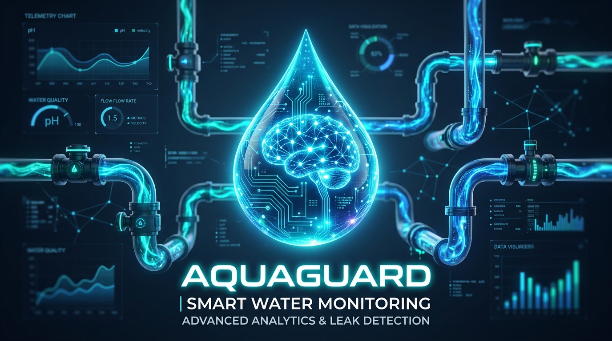
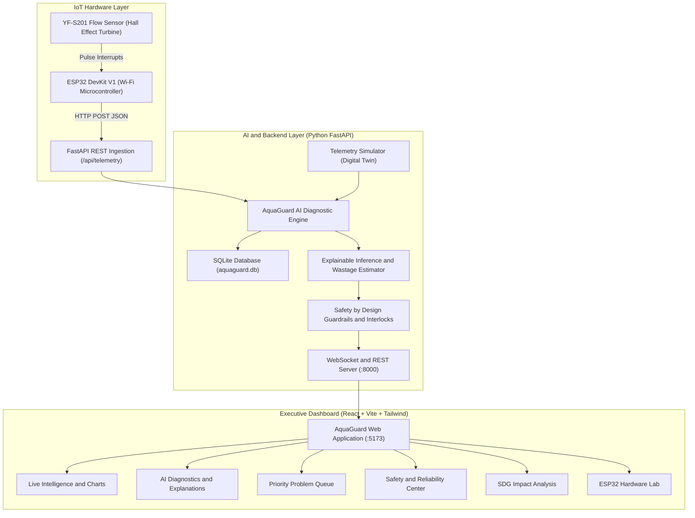

# AquaGuard: AI-Powered Water Intelligence



> **Intelligent, real-time water monitoring, acoustic-volumetric anomaly detection, and leak diagnostics for colleges, hostels, apartments, and enterprises.**

[](https://aquaguard-jobw.onrender.com)
[](https://github.com/Nagashri05/AquaGuard)
[](https://fastapi.tiangolo.com/)
[](https://react.dev/)
[](https://tailwindcss.com/)
[](https://opensource.org/licenses/MIT)

---

### 🌐 Live Deployment
- 🖥️ **Live Web App & Dashboard**: [https://aquaguard-jobw.onrender.com](https://aquaguard-jobw.onrender.com)
- 📖 **Interactive Swagger API Docs**: [https://aquaguard-jobw.onrender.com/docs](https://aquaguard-jobw.onrender.com/docs)
- 📡 **Physical IoT Telemetry Ingestion**: `POST https://aquaguard-jobw.onrender.com/api/telemetry`

---

> 💡 **Hardware & Simulation Support**:  
> AquaGuard features a **hardware-ready architecture** with both real physical ESP32 streaming and a complete built-in **Digital Twin Simulator**. The platform can be evaluated end-to-end with or without physical sensors attached. Ready-to-flash ESP32 C++ firmware and circuit schematics are provided in the [`firmware/`](./firmware) directory.

---

## 🌟 Key Innovations

1. **Multi-Factor AI Anomaly Detection Engine**
   - Classifies fluid dynamics into `NORMAL`, `POSSIBLE LEAK`, `HIGH-RISK ANOMALY`, and `INSUFFICIENT EVIDENCE`.
   - Incorporates continuous flow duration, diurnal baselines (time-of-day campus curve), sudden consumption spikes, and signal variance.
   - Refuses definitive physical claims: phrased as *"possible leak detected"* or *"abnormal usage detected"*.

2. **Explainable Diagnostics with Confidence Scores**
   - Every alert includes an explicit reason, calibrated confidence score (e.g. 87%, 96%), observational evidence list, differential hydraulic causes, and concrete next actions.

3. **Safety by Design & Reliability Guardrails**
   - **Hardware/Software Auto-Shutoff Lock**: Prohibits automated valve closures to protect critical services and fire risers from false alarms.
   - **Mandatory Human-in-the-Loop**: Requires certified physical inspection before intervention.
   - **Measured vs. Estimate Transparency**: Clear visual and schematic distinction between raw physical sensor telemetry and statistical projections.
   - **Noise Fallback**: Automatically degrades to "Insufficient Evidence" when sensor jitter or packet loss is detected.

4. **Dynamic Priority Problem Queue**
   - Ranks detected infrastructure issues using: $\text{Severity} \times \text{Confidence} \times \text{Continuous Duration} \times \text{Estimated Water Wastage}$.

5. **Physical IoT + Hardware-Free Demo Mode**
   - Direct REST API endpoint (`POST /api/telemetry`) accepting real ESP32 microcontroller packets.
   - 4-step interactive judge demo suite: **Normal Flow (0.3 L/min)** &rarr; **Small Leak (2.4 L/min)** &rarr; **Major Leak (14.8 L/min)** &rarr; **Noisy/Uncertain Data**.
   - Includes **Automated 1-Click Guided Demo Tour** with on-screen AI narration.

6. **UN Sustainable Development Goals (SDG) Alignment**
   - Directly contributes to **SDG 6** (Clean Water & Sanitation), **SDG 11** (Sustainable Cities & Communities), and **SDG 12** (Responsible Consumption & Production) with live savings counters.

---

## 📐 System Architecture



---

## 🚀 Quick Start Guide (Clone & Run in 2 Minutes)

### Prerequisites
- **Python 3.10+**
- **Node.js v18+** & `npm`

### Step 1: Clone Repository
```bash
git clone https://github.com/Nagashri05/AquaGuard.git
cd AquaGuard
```

### Step 2: Install Dependencies
```bash
# Install Python backend dependencies
pip install -r requirements.txt

# Install React frontend dependencies
cd frontend
npm install
cd ..
```

### Step 3: Launch AquaGuard
```bash
python run_aquaguard.py
```
This automatically starts:
- **FastAPI Backend Server**: [http://127.0.0.1:8000](http://127.0.0.1:8000)
- **API Swagger Documentation**: [http://127.0.0.1:8000/docs](http://127.0.0.1:8000/docs)
- **Vite React Frontend**: [http://localhost:5173](http://localhost:5173)

---

## 🎮 Interactive Simulation & Scenario Walkthrough

Open your browser to [http://localhost:5173](http://localhost:5173) and use the **Demo Control Studio** at the top:

### 🌟 Option A: Automated 1-Click Tour (Recommended)
Click the green **`▶ Start Automated Live Tour`** button. The dashboard will automatically cycle through all 4 real-world plumbing scenarios every 7 seconds, with an animated on-screen AI explanation banner explaining what is happening.

### 🕹️ Option B: Manual Interactive Walkthrough
1. **Step 1: Normal Baseline Flow**
   - Click **`1. Normal Flow`** (Flow: `0.30 L/min`).
   - *Result*: Status shows `NORMAL`. The AI indicates usage matches the diurnal baseline. Active alerts count is `0`.
2. **Step 2: The Silent Leak**
   - Click **`2. Small Leak`** (Flow: `2.40 L/min`).
   - *Result*: Status updates to **`POSSIBLE LEAK DETECTED`**, Risk: `Medium`, Confidence: `87%`.
   - *Wastage*: Highlights **~2,952 Liters/day** lost if left unchecked.
   - *Explanation*: Click **AI Diagnostics** to see observational evidence of 18 minutes unbroken continuous flow during off-hours.
3. **Step 3: Major Rupture Anomaly**
   - Click **`3. Major Leak`** (Flow: `14.80 L/min`).
   - *Result*: Status escalates to **`HIGH-RISK ANOMALY DETECTED`**, Risk: `High`, Confidence: `96%`.
   - *Priority Queue*: Automatically escalates Hostel Block B to `HIGH PRIORITY` with over **20,000 L/day** at risk.
4. **Step 4: Noisy / Uncertain Data (Defensive AI)**
   - Click **`4. Noisy Data`** (Erratic flow oscillation).
   - *Result*: Status shows **`INSUFFICIENT EVIDENCE`** (Confidence: `38%`):
     > *"Please collect better sensor data before taking action."*
   - *Safety Guardrail*: Prevents false alarms when sensors experience hydraulic turbulence or wiring flutter.
5. **Step 5: Physical Hardware Test**
   - Open the **`ESP32 IoT Lab`** tab.
   - Enter `3.5 L/min` and click **`Dispatch HTTP POST to Backend`**.
   - Demonstrates that external microcontrollers stream directly into the live intelligence engine.

---

## 🌍 UN Sustainable Development Goals (SDG) Alignment

- **SDG 6 (Clean Water and Sanitation)**: Early detection prevents silent subterranean and cistern wastage, conserving over **30,000 liters monthly** per monitored building.
- **SDG 11 (Sustainable Cities and Communities)**: Protects campus buildings and apartment risers from structural water degradation, mold, and ceiling collapses.
- **SDG 12 (Responsible Consumption and Production)**: Eliminates municipal booster pumping energy (~0.45 kWh/m³) and avoids carbon emissions associated with water distribution.

---

## 🛠️ REST API Reference

| Endpoint | Method | Description |
| :--- | :--- | :--- |
| `/api/telemetry` | `POST` | Hardware ingestion endpoint for ESP32 readings |
| `/api/telemetry/live` | `GET` | Instantaneous flow and AI diagnostic state |
| `/api/telemetry/history` | `GET` | Historical time series for charts |
| `/api/alerts` | `GET` | Prioritized queue of detected plumbing issues |
| `/api/demo/scenario` | `POST` | Switches demo scenario (`normal`, `small_leak`, `major_leak`, `noisy`) |
| `/api/demo/mode` | `POST` | Toggles between physical hardware and demo simulator |
| `/api/impact/sdg` | `GET` | Returns live UN SDG impact calculations |
| `/api/safety` | `GET` | Returns Safety by Design compliance status |
| `/ws/live` | `WebSocket` | Real-time bidirectional streaming |

---

## 📜 Safety by Design Declaration

AquaGuard adheres strictly to safety principles:
- **No Definitive Accusations**: Evaluates evidence probabilistically without overclaiming physical leaks.
- **Mandatory Human-in-the-Loop**: Automated shut-off valves are locked; inspection must precede intervention.
- **Transparent Labelling**: Measured telemetry is explicitly segregated from algorithmic projections.
