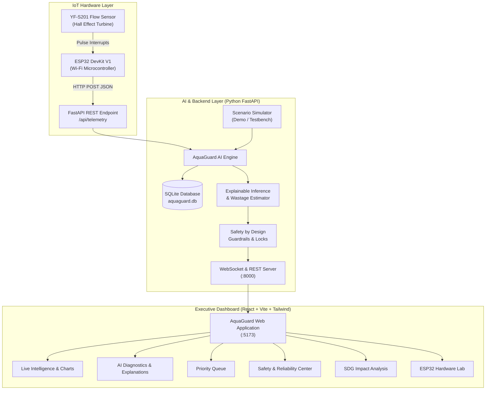

# AquaGuard: AI-Powered Water Intelligence

> **Intelligent, real-time water monitoring and acoustic-volumetric anomaly detection for colleges, hostels, apartments, and enterprises.**

AquaGuard transforms ordinary water infrastructure into an intelligent, sustainable network. By pairing low-cost IoT turbine flow sensors (ESP32 + YF-S201) with a multi-factor AI diagnostic engine, AquaGuard catches invisible leaks, calculates real-time excess consumption, and prioritizes physical maintenance before millions of liters are wasted.

---

## 🌟 Key Innovations

1. **Multi-Factor AI Anomaly Detection Engine**
   - Classifies fluid dynamics into `NORMAL`, `POSSIBLE LEAK`, `HIGH-RISK ANOMALY`, and `INSUFFICIENT EVIDENCE`.
   - Incorporates continuous flow duration, diurnal baselines (time-of-day campus curve), sudden consumption spikes, and signal variance.
   - Refuses definitive physical claims: phrased as *"possible leak detected"* or *"abnormal usage detected"*.

2. **Explainable Diagnostics with Confidence Scores**
   - Every alert includes an explicit reason, calibrated confidence score (e.g. 87%, 96%), observational evidence list, differential hydraulic causes, and concrete next actions.

3. **Safety by Design & Reliability Guardrails**
   - **Hardware/Software Auto-Shutoff Lock**: Prohibits automated valve closures to protect critical services and fire risers from false alarms.
   - **Mandatory Human-in-the-Loop**: Requires certified physical inspection before intervention.
   - **Measured vs. Estimate Transparency**: Clear visual and schematic distinction between raw physical sensor telemetry and statistical projections.
   - **Noise Fallback**: Automatically degrades to "Insufficient Evidence" when sensor jitter or packet loss is detected.

4. **Dynamic Priority Problem Queue**
   - Ranks detected infrastructure issues using: $\text{Severity} \times \text{Confidence} \times \text{Continuous Duration} \times \text{Estimated Water Wastage}$.

5. **Physical IoT + Hardware-Free Demo Mode**
   - Direct REST API endpoint (`POST /api/telemetry`) accepting real ESP32 microcontroller packets.
   - 4-step interactive judge demo suite: **Normal Flow (0.3 L/min)** &rarr; **Small Leak (2.4 L/min)** &rarr; **Major Leak (14.8 L/min)** &rarr; **Noisy/Uncertain Data**.

6. **UN Sustainable Development Goals (SDG) Alignment**
   - Directly contributes to **SDG 6** (Clean Water & Sanitation), **SDG 11** (Sustainable Cities & Communities), and **SDG 12** (Responsible Consumption & Production) with live savings counters.

---

## 📐 System Architecture



---

## 🚀 Quick Start Guide

### Prerequisites
- **Python 3.10+** (with `fastapi`, `uvicorn`, `scikit-learn` installed)
- **Node.js v18+** & `npm`

### 1. Launch Everything in One Command
From the project root:
```bash
python run_aquaguard.py
```
This automatically starts:
- **FastAPI Backend Server**: `http://127.0.0.1:8000`
- **Vite React Frontend**: `http://localhost:5173`

---

## 🎭 Hackathon Presentation Walkthrough (Judges Demo Script)

Open your browser to `http://localhost:5173` and use the **Judge Demo Control Studio** bar at the top:

1. **Step 1: Normal Operation (Baseline)**
   - Click **`1. Normal Flow`** (Flow: `0.30 L/min`).
   - *Result*: Status shows `NORMAL`. The AI indicates usage matches the diurnal baseline. Active alerts count is `0`.

2. **Step 2: Small Continuous Leak**
   - Click **`2. Small Leak`** (Flow: `2.40 L/min`).
   - *Result*: Status updates to **`POSSIBLE LEAK DETECTED`**, Risk: `Medium`, Confidence: `87%`.
   - Point out: The AI explains that water flow remained sustained for over 18 minutes during expected low usage. Shows estimated daily wastage (~3,000 L/day).

3. **Step 3: Major Rupture Anomaly**
   - Click **`3. Major Leak`** (Flow: `14.80 L/min`).
   - *Result*: Status escalates to **`HIGH-RISK ANOMALY DETECTED`**, Risk: `High`, Confidence: `96%`.
   - Point out: Estimated water at risk exceeds 20,000 L/day. Priority queue ranks this as `HIGH PRIORITY` at Hostel Block B.

4. **Step 4: Noisy / Uncertain Sensor Data**
   - Click **`4. Noisy Data`** (Erratic flow oscillation).
   - *Result*: Status shows **`INSUFFICIENT EVIDENCE`** with message:
     > *"Please collect better sensor data before taking action."*
   - Point out: **Defensive Safety AI** prevents false alarms when sensors have wiring flutter or pipeline air pockets.

5. **Step 5: Physical Hardware Test**
   - Open the **`ESP32 IoT Lab`** tab.
   - Click **`Dispatch HTTP POST to Backend`** or run the provided `curl` command.
   - Show how external IoT microcontrollers stream directly into the live intelligence engine.

---

## 🌍 UN Sustainable Development Goals (SDG) Alignment

- **SDG 6 (Clean Water and Sanitation)**: Early detection prevents silent subterranean and cistern wastage, conserving over 30,000 liters monthly per monitored building.
- **SDG 11 (Sustainable Cities and Communities)**: Protects campus buildings and apartment risers from structural water degradation, mold, and ceiling collapses.
- **SDG 12 (Responsible Consumption and Production)**: Eliminates municipal booster pumping energy (~0.45 kWh/m³) and avoids carbon emissions associated with water distribution.

---

## 🛠️ REST API Reference

| Endpoint | Method | Description |
| :--- | :--- | :--- |
| `/api/telemetry` | `POST` | Hardware ingestion endpoint for ESP32 readings |
| `/api/telemetry/live` | `GET` | Instantaneous flow and AI diagnostic state |
| `/api/telemetry/history` | `GET` | Historical time series for charts |
| `/api/alerts` | `GET` | Prioritized queue of detected plumbing issues |
| `/api/demo/scenario` | `POST` | Switches demo scenario (`normal`, `small_leak`, `major_leak`, `noisy`) |
| `/api/demo/mode` | `POST` | Toggles between physical hardware and demo simulator |
| `/api/impact/sdg` | `GET` | Returns live UN SDG impact calculations |
| `/api/safety` | `GET` | Returns Safety by Design compliance status |
| `/ws/live` | `WebSocket` | Real-time bidirectional streaming |

---

## 📜 Safety by Design Declaration

AquaGuard adheres strictly to safety principles:
- **No Definitive Accusations**: Evaluates evidence probabilistically without overclaiming physical leaks.
- **Mandatory Human-in-the-Loop**: Automated shut-off valves are locked; inspection must precede intervention.
- **Transparent Labelling**: Measured telemetry is explicitly segregated from algorithmic projections.
